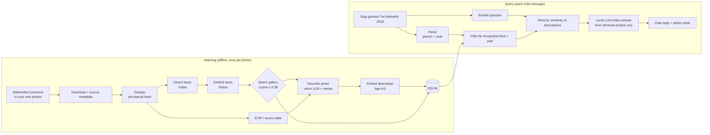

# FaceSearch

Chat with a photo archive. Ask *"Bagi gambar Tun Mahathir"* and FaceSearch returns photos of him, each with
an AI-written description and its metadata (date, source, author, license). You can also upload a photo
to find every archive photo with the same face, or browse the whole archive by person and year.

Everything runs **locally**: no cloud APIs, and photos never leave the computer.

| Requirement        | How it is done                                                                 |
| ------------------ | ------------------------------------------------------------------------------ |
| Face recognition   | OpenCV **YuNet** (detection) + **SFace** (128-d face embeddings), CPU          |
| Image descriptions | Local vision-language model through **Ollama** (`qwen2.5vl:3b`)                |
| Metadata           | EXIF from the file + structured metadata from Wikimedia Commons                |
| RAG                | Query parsing → face/year filter + vector search → local LLM answer (`qwen2.5:3b`) |
| Embeddings         | `bge-m3` (multilingual, so Malay questions match English descriptions)         |
| Storage            | SQLite (images, faces, vectors), searched in memory with numpy                 |
| Website            | React + Vite (this folder) talking to a FastAPI backend                        |

---

## Pipeline



### Indexing (`python cli.py index`)

1. **Source**: photos are downloaded from Wikimedia Commons by category (one per person in `people.json`),
   with each file's date, caption, author and license saved to `data/raw/<person>/metadata.json`.
   Internet photos usually have their EXIF removed, so the source page is the main place the date comes from.
2. **Dedupe**: the same photo is often uploaded several times. A perceptual hash skips near-identical copies.
3. **Face recognition**: YuNet finds each face, SFace turns it into a 128-number vector, and it is compared
   with the reference **gallery** (5-10 clear photos per person). The score is the mean of the 3 closest
   reference faces; at or above the threshold it counts as a match, otherwise "unknown".
4. **Metadata**: the date comes from EXIF if present, otherwise from the source. Camera and GPS are read from
   EXIF when available.
5. **Description**: the vision model describes the photo. It is told who face recognition found and where
   each person is in the frame ("on the left"), so the description uses real names instead of "a man in a
   suit". If the model still leaves a name out, it is added in front of the description.
6. **Embedding**: names + date + description + source caption are combined into one text, embedded with
   `bge-m3` and saved to SQLite with the face boxes.

### Query (`/api/chat`)

1. **Parse**: a rule-based parser finds the person (aliases, titles such as Tun/Datuk/Dr, and typos such as
   "Mahatir") and the years. Rules are more predictable than a small LLM for this step.

   | Question says                                   | Years searched            |
   | ----------------------------------------------- | ------------------------- |
   | "2015", "dari tahun 2015", "from 2015"          | 2015 only                 |
   | "2013-2015", "antara 2013 dan 2015"             | 2013 to 2015              |
   | "2015 dan 2018"                                 | 2015 or 2018 (not between)|
   | "sejak 2015" / "selepas 2015"                   | 2015+ / 2016+             |
   | "sebelum 2010" / "hingga 2010"                  | up to 2009 / up to 2010   |
   | "1990an", "1990s"                               | 1990 to 1999              |
   | "tahun lepas", "tahun ini"                      | last year / this year     |

2. **Retrieve**: keep photos where face recognition found that person (and match the years), then rank
   them by how similar the question is to each description. With no person, it is a pure semantic search
   ("people at a press conference"). Photos from the person's source folder whose face could not be
   confirmed (side profile, too small) are shown last and flagged.
3. **Generate**: the local LLM gets only the retrieved photos' descriptions and metadata and writes a short
   reply in the user's language, citing photos as [1], [2]. It is told never to invent dates. The photos
   appear first and the reply is **streamed word by word** (`/api/chat/stream`) as the model writes it.
   If no photo matches the year, the reply lists the years that person does have photos from.
4. **Follow-ups**: "yang tahun 2019 pula?" keeps the person from the previous question.

### Search by face (`/api/face-search`)

Upload, paste or drop a photo. The largest face is compared with **every face in the archive**, not only the
gallery, so it also finds people who are not in `people.json`.

### Live search from Wikimedia Commons

When the archive has fewer than 6 confirmed photos for a question about one person (for example a year
it has nothing for), FaceSearch fetches more from Wikimedia Commons on the spot:

1. `python cli.py catalog` has already recorded every Commons file for each person, with its date and
   download link (no photos downloaded). So the live search knows instantly which files match the year.
2. Up to 12 of those files are downloaded in parallel (25-second limit), files that name the person first.
3. Each one goes through the face check (YuNet + SFace). Only photos where the person's face matches their
   reference faces are shown; the rest are saved to the archive for other searches.
4. The photos are shown straight away with the **Commons caption** as a temporary description
   ("Commons caption · AI description pending"). A background thread in the server writes the AI
   descriptions afterwards, pausing while someone is chatting, so the next search shows them.
5. Everything is saved, so asking again is instant and doesn't fetch again.

Without internet, or with `FS_LIVE_FETCH=0`, it silently uses the archive only. On a laptop CPU a live
search adds roughly 5-15 seconds; describing each new photo in the background takes 20-90 seconds.
Running `python cli.py catalog` again only does people not catalogued yet (e.g. after a failure); use
`--refresh` now and then to pick up new uploads on Commons. Wikimedia throttles anonymous clients
("429 Too Many Requests"); the command waits and retries, and setting `FS_WIKI_USER_AGENT` to something
with your contact (e.g. `FaceSearch/0.1 (internship project; you@example.com)`) reduces it.

### New public figures from Wikidata

Ask for someone who isn't in `people.json` ("Bagi gambar Obama", "show me Joe Biden") and FaceSearch
learns them on the spot:

1. **Who is it?** The name is looked up on **Wikidata**. Only a *human* with a *Wikipedia article* is
   accepted, i.e. a public figure, and every word you typed must match their name or an alias (so
   "Obama" finds Barack Obama, not the Japanese city of Obama).
2. **Learn the face.** From Wikidata come the official portrait (P18) and the Commons category. FaceSearch
   searches Commons for photos tagged as *depicting* the person (their Wikidata id), adds their category,
   downloads the portrait plus ~11 likely portraits, and keeps as reference faces the clear single-face
   photos that match the portrait. Titles typed with the name ("Tunku Abdul Rahman") are searched first.
3. **Save and search.** The person is added to `data/people_auto.json` (your `people.json` is untouched),
   the photos are indexed, every face already in the archive is re-checked (so they're recognised in old
   photos too), and the search runs as normal, including live search for more photos.

The first question about a new person takes roughly 10-30 seconds; after that they're like anyone in
`people.json`. Turn it off with `FS_AUTO_PEOPLE=0`. If it learned the wrong namesake, remove them with
`python cli.py forget <id>` (ids are in `data/people_auto.json`; add `--delete-photos` to also delete
their downloaded photos).

Search **by face** (uploading a photo) still only searches your own archive: FaceSearch identifies
people by name, never strangers from a photo.

### All photos (`/api/images`)

The **All photos** tab lists every indexed photo, filtered by person (including **Unidentified**: photos
where nobody was recognised) and by year, sorted newest, oldest or recently added. Chat answers about one
person link to it ("See all photos of …"). The Unidentified filter is a quick way to spot people that face
recognition missed and add them to the gallery.

---

## Setup (Windows)

You need **Python 3.10-3.13**, **Node.js 20+** and **[Ollama](https://ollama.com/download)**.

### 1. Local AI models (once)

Install Ollama, then in a terminal:

```powershell
ollama pull qwen2.5vl:3b   # describes photos
ollama pull qwen2.5:3b     # writes chat answers
ollama pull bge-m3         # embeddings
```

### 2. Backend

```powershell
cd backend
python -m venv .venv
.venv\Scripts\activate
pip install -r requirements.txt

python cli.py models                     # face models (~40 MB)
python cli.py download --per-person 40   # photos + metadata from Wikimedia Commons
python cli.py gallery                    # reference faces per person
```

**Check the gallery.** Open `backend\data\gallery\<person>\` and delete any photo that shows the wrong
person, then run `python cli.py gallery` again. Recognition is only as good as these photos.

```powershell
python cli.py evaluate                   # accuracy on photos not in the gallery
python cli.py index                      # faces -> descriptions -> embeddings
python cli.py catalog                    # list Commons files + dates per person (for live search)
python server.py                         # start the API on port 8000
```

If `uvicorn` or another command is "not recognized", Python's Scripts folder isn't on your PATH. Run it
through Python instead: `python -m uvicorn server:app --port 8000`.

Without a GPU, describing a photo can take tens of seconds. Try `python cli.py index --limit 20` first, or
`--no-captions` to skip descriptions for a quick test (the source caption is used instead).

### 3. Website

In a second terminal, from this folder:

```powershell
npm install
npm run dev
```

Open http://localhost:5173. The status pill at the top shows whether the backend, Ollama and the index are ready.

---

## Adding people or your own photos

- **New person**: add an entry to `backend/people.json` (`id`, `name`, `aliases`, `commons_category`), then
  run `download --only <id>`, `gallery`, `index`.
- **Your own photos**: put them in any folder under `backend/data/raw/` (e.g. `data/raw/event-2026/`) and run
  `index`. Faces are recognised whatever folder they are in. EXIF dates are read automatically.
- **Changed the gallery?** Run `python cli.py relabel` to re-identify stored faces without re-describing photos.
- **Descriptions not naming people?** Run `python cli.py redescribe` to regenerate the AI descriptions
  (faces are kept). Add `--all` to also redo photos with no recognised person.
- `python cli.py index` reloads the running server when it finishes; otherwise call `POST /api/reload`.
- **New person and live search:** after adding them to `people.json` and building their gallery, run
  `python cli.py catalog --only <id>` so live search can fetch more of their photos.

## Settings

Environment variables (see `backend/facesearch/config.py`):

| Variable               | Default        | Notes                                              |
| ---------------------- | -------------- | -------------------------------------------------- |
| `FS_FACE_THRESHOLD`    | `0.38`         | Raise if wrong people are matched, lower if too many are "unknown" |
| `FS_VISION_MODEL`      | `qwen2.5vl:3b` | `gemma3:4b`, `llava:7b`, or `moondream` (faster, English only) |
| `FS_CHAT_MODEL`        | `qwen2.5:3b`   | Any Ollama chat model                              |
| `FS_EMBED_MODEL`       | `bge-m3`       | Re-index with `--force` after changing             |
| `FS_TOP_K`             | `6`            | Photos per answer                                  |
| `FS_WIKI_USER_AGENT`   | generic        | Wikimedia asks for a contact in the user agent     |
| `FS_LIVE_FETCH`        | `1`            | `0` turns off live search from Wikimedia Commons   |
| `FS_AUTO_PEOPLE`       | `1`            | `0` stops learning new public figures from Wikidata |
| `FS_LIVE_MAX`          | `12`           | Most photos downloaded per live search             |
| `FS_LIVE_SECONDS`      | `25`           | Time limit for one live search                     |
| `FS_BACKGROUND_DESCRIBE` | `1`          | `0` stops the server writing AI descriptions in the background |

## API

| Method | Path               | Purpose                                     |
| ------ | ------------------ | ------------------------------------------- |
| GET    | `/api/health`      | Ollama/model status, index counts           |
| GET    | `/api/people`      | Known people with photo counts              |
| POST   | `/api/chat`        | `{message, history}` → answer + photos      |
| POST   | `/api/chat/stream` | Same, streamed as NDJSON: photos, then words, then done |
| GET    | `/api/images`      | All photos; `?person=&year=&sort=&offset=&limit=` |
| POST   | `/api/face-search` | multipart `file` → detected faces + photos  |
| GET    | `/api/images/{id}` | One photo with full metadata                |
| POST   | `/api/reload`      | Reload the index after indexing             |
| GET    | `/media/...`       | The photo files                             |

Interactive docs: http://localhost:8000/docs

## Project structure

```
FaceSearch/
├── src/                     React website
│   ├── App.jsx              landing page, chat, face upload, Search / All photos tabs
│   ├── api.js               calls to the backend
│   └── components/          Composer, Message, Browse, ImageCard, Lightbox, FaceBoxes, FaceThumb
├── vite.config.js           proxies /api and /media to the backend
└── backend/
    ├── cli.py               pipeline commands
    ├── server.py            FastAPI app
    ├── people.json          who to recognise (names, aliases, Commons category)
    ├── facesearch/
    │   ├── commons.py       Wikimedia Commons downloader + catalog
    │   ├── live.py          live search from Commons + background AI descriptions
    │   ├── wikidata.py      finds a public figure by name on Wikidata
    │   ├── onboard.py       learns a new person's face from Commons
    │   ├── faces.py         YuNet + SFace, gallery matching
    │   ├── metadata.py      EXIF + date normalisation
    │   ├── llm.py           Ollama client (describe, chat, embed)
    │   ├── indexer.py       gallery, indexing, relabel, redescribe, evaluation
    │   ├── parse.py         query understanding (person, years)
    │   ├── search.py        retrieval + answer generation (RAG), browsing
    │   └── store.py         SQLite schema
    ├── models/              face models (downloaded, not in git)
    └── data/                photos, gallery, index.db (not in git)
```

## Use cases

- **Newsrooms and media archives**: find every photo of a minister from a given year in seconds, with
  the date and credit ready for the caption.
- **Government, museums and the National Archives**: make large historical photo collections searchable
  by person and description instead of by file name.
- **Corporate communications**: search years of event photos for a specific executive or guest.
- **Event photography**: guests upload a selfie and get every photo they appear in.
- **Personal or family photo libraries**: private face search that never uploads photos to the cloud.

## Limitations and privacy

- Face embeddings are biometric data and count as personal data under Malaysia's **PDPA 2010**. Real
  deployments need consent or a clear legal basis, access control, and a way to delete a person's data.
  Running locally keeps photos and embeddings on this computer.
- Use public figures or people who have agreed. The Commons photos keep their licenses (shown in the
  photo details); credit the author when reusing them.
- Recognition is weaker on side profiles, very small faces, heavy shadows and old black-and-white photos.
  Run `evaluate` and adjust the threshold.
- Small local models can still write imperfect descriptions. The source caption is kept next to the AI
  description so they can be compared.
